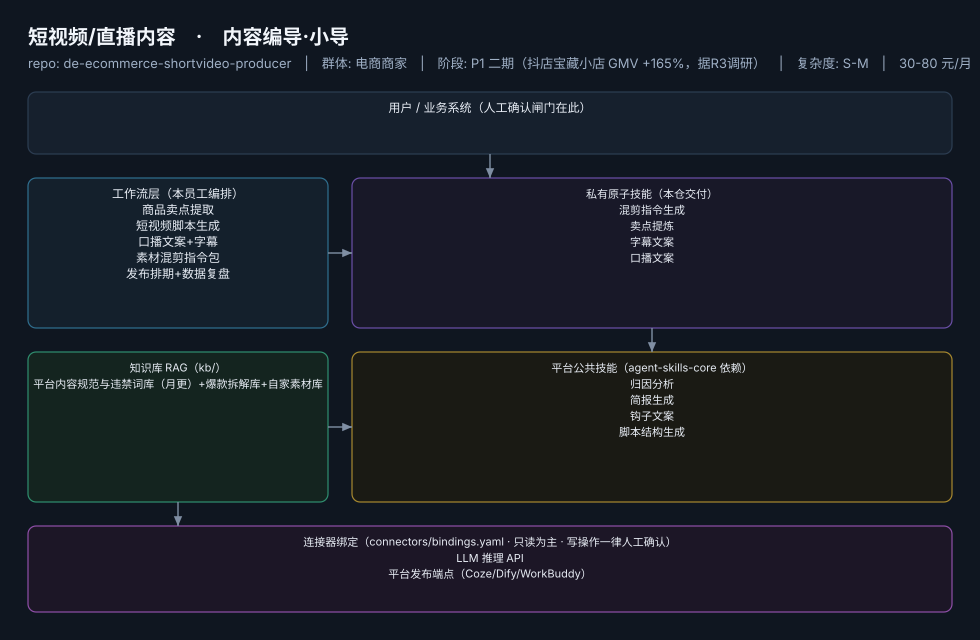

# 短视频/直播内容

> 内容编导·小导 ｜ 不替你拍视频，只解决"今天拍什么、开头 3 秒说什么、发完怎么复盘"
>
> **内容编导·小导**　·　电商商家　·　阶段 P1 二期（抖店宝藏小店 GMV +165%，据R3调研）　·　
> 复杂度 S-M　·　30-80 元/月　·　定义卡 6.4-⑤

## 演示（真实执行录播）


*真实执行回放（GIF 自动循环，非摆拍）· [▶ 观看完整版 MP4](workflows/wf-ecom-video-script/docs/images/08-demo-run.mp4) · 台账见 [`reports/real-run/wf-ecom-video-script.md`](reports/real-run/wf-ecom-video-script.md)*



## 效果（真实执行）


*上图为**真实效果对比**，不是示意图：左栏是输入材料与要求，右栏是该次执行的产出原文，
两栏取自同一次真实执行记录。*

- 完整台账：[`reports/real-run/wf-ecom-video-script.md`](reports/real-run/wf-ecom-video-script.md)
- 录屏与终端回放：[`workflows/wf-ecom-video-script/docs/images/`](workflows/wf-ecom-video-script/docs/images/)（`08-demo-run.gif` / `08-demo-run.mp4` / `04-terminal-run.png`）
- 使用示例：[`workflows/wf-ecom-video-script/docs/使用示例.md`](workflows/wf-ecom-video-script/docs/使用示例.md)
> 实测判定：**通过**　·　可用度 4/5　·　编造数字 0 处　·　红线命中 2 次 / 拦截 2 次


**一句话**：周更 3 条以上内容的抖店/小红书卖家

---

## 这个数字员工解决什么问题

内容编导·小导 ｜ 不替你拍视频，只解决"今天拍什么、开头 3 秒说什么、发完怎么复盘"

| 项 | 内容 |
|---|---|
| 服务对象 | 周更 3 条以上内容的抖店/小红书卖家 |
| 可量化目标 | 周均脚本 ≥10 条；脚本采用率 ≥50%；发布后复盘覆盖率 100% |
| 投入产出 | 月省选题写稿约 25h≈¥750 vs 月费 ≤¥80 |
| 需求依据 | D01、D21 |
| 分发渠道 | GitHub、抖音、快手、小红书（用 AI 脚本拍"AI 帮我写脚本"视频，自证式引流） |

## 30 秒上手

```bash
git clone <本仓库地址> && cd de-ecommerce-shortvideo-producer
pip install pyyaml
python3 tests/run.py            # 先跑一遍自检，确认环境与契约都对得上
```

试用（把 `<输入>` 换成本人真实材料）：

```text
请以「短视频/直播内容」的身份，帮我跑「商品卖点提取」。
材料如下：<输入>
要求：只使用材料里出现过的数字，缺的写 <待填>；对外文案停在待确认状态。
```

详细接入见 [`docs/01-安装与接入.md`](docs/01-安装与接入.md)。

## 仓库结构

```text
de-ecommerce-shortvideo-producer/
├── employee.md            # 人读定义卡（12 主字段 + 2 扩展组，由 employee.yaml 生成）
├── employee.yaml          # 机器契约（能力清单 + 依赖锁）
├── dependencies.yaml      # 对 core 的外部依赖（含版本）
├── persona/               # 运行提示词 / 边界 / KPI
├── skills/                # 私有原子技能（4 个）
├── spec-bindings/         # 有意不公共化能力的本地绑定声明（0 个）
├── workflows/             # 本员工工作流（5 条）
├── kb/                    # 知识库 RAG 契约
├── connectors/            # 连接器绑定（只读为主，写操作人工确认）
├── docs/                  # 六类发布文档
└── tests/                 # 自动化多场景测试
```

## 私有原子技能（4）

| 技能 | slug | 复杂度 | 阶段 | 成熟度 |
|---|---|---|---|---|
| `混剪指令生成` | `mixcut-instruction-generator` | S | P1 | 契约完备 |
| `卖点提炼` | `sellingpoint-extract` | S | P1 | 已实现 |
| `字幕文案` | `subtitle-copy` | S | P1 | 契约完备 |
| `口播文案` | `voiceover-script` | S | P1 | 契约完备 |

## 平台公共技能依赖（4）

| 技能 | slug | 全平台复用员工数 |
|---|---|---|
| `归因分析` | `attribution-analysis` | 4 |
| `简报生成` | `brief-generator` | 10 |
| `钩子文案` | `hook-copy` | 2 |
| `脚本结构生成` | `script-structure` | 3 |

> 这些技能来自 `agent-skills-core@1.0.0`，本仓库**只引用不复制**。

## Spec 绑定层（0）

（无）

> 这一族能力**有意不公共化**（与外部平台接口强绑定）。本仓不存正文，
> 只留本地绑定声明与连接器配置。

## 工作流（5）

| 工作流 | slug | 触发 | 阶段 | 调用技能数 |
|---|---|---|---|---|
| `商品卖点提取` | `wf-ecom-video-sellingpoint` | 人工 | P1 | 1 |
| `短视频脚本生成` | `wf-ecom-video-script` | 人工 | P1 | 2 |
| `口播文案+字幕` | `wf-ecom-video-voiceover-subtitle` | 人工 | P1 | 2 |
| `素材混剪指令包` | `wf-ecom-video-slice` | 人工 | P2 | 1 |
| `发布排期+数据复盘` | `wf-ecom-video-live-script` | 定时（每日/每周） | P2 | 2 |

## 知识库与连接器

- 知识库语料：['平台内容规范与违禁词库（月更）+爆款拆解库+自家素材库']
- 连接器：LLM 推理 API、平台发布端点（Coze/Dify/WorkBuddy）

## 质量与验收

| 项 | 值 |
|---|---|
| 技能文件数 | 214 |
| 多场景用例数 | 253 |
| 用例通过 | 253 |
| 验收结论 | ✅ 通过 |

完整报告：[`docs/05-验收与测试.md`](docs/05-验收与测试.md)

## 许可

专有许可，详见 [`LICENSE`](LICENSE)。
