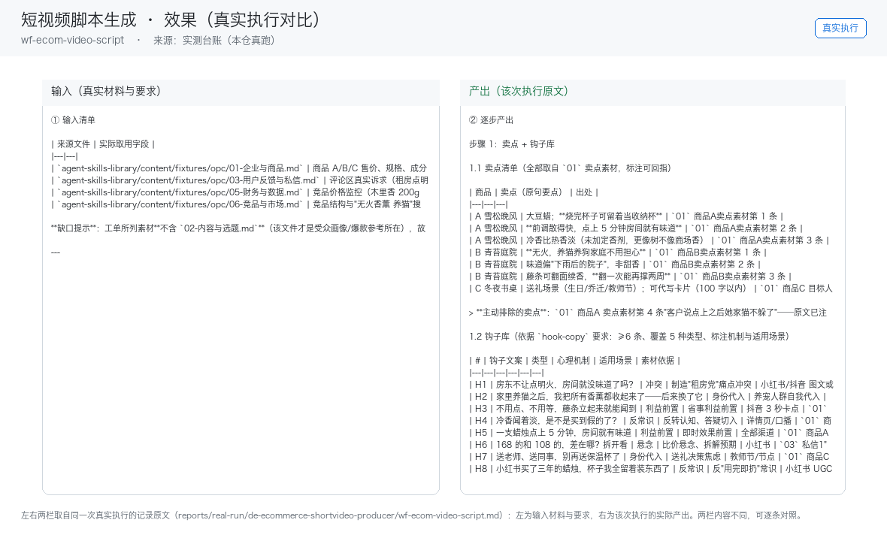

# 03 · 场景与价值

## 谁在用

周更 3 条以上内容的抖店/小红书卖家

## 三个典型场景

### 场景 A：商品卖点提取
- **触发**：人工
- **之前**：人工从头做一遍，每次口径不一、结果不可比
- **之后**：商品资料→卖点清单→分平台话术
- **收益**：月省选题 8h≈¥240

### 场景 B：短视频脚本生成
- **触发**：人工
- **之后**：卖点+钩子库→分镜脚本
- **收益**：月省写稿 15h≈¥450

### 场景 C：口播文案+字幕
- **触发**：人工
- **之后**：脚本→口播稿→字幕文件
- **收益**：直接进剪辑流程，零二次加工

## 价值构成

| 维度 | 说明 |
|---|---|
| 省时间 | 月省选题写稿约 25h≈¥750 vs 月费 ≤¥80 |
| 提一致性 | 同一能力固化成技能，口径不再因人而异 |
| 降风险 | 业务红线写死在提示词里，越界即停 |
| 可审计 | 每个数字可回指输入，产出可追溯 |

## 与人工的边界

本员工**不替代决策**。它负责把重复劳动做成清单与初稿，
把决策点（要不要发、要不要改价、要不要道歉）留给人。

## 效果证据（真实执行）

**左输入 / 右产出**的对比图，取自一次真实执行（不是示意图、不是环境探测截图）：

| 证据 | 位置 |
|---|---|
| 完整台账（输入清单 + 逐步产出 + 质检 + 如实说明） | [`../reports/real-run/wf-ecom-video-script.md`](../reports/real-run/wf-ecom-video-script.md) |
| 效果对比图 | [`../workflows/wf-ecom-video-script/docs/images/00-effect.png`](../workflows/wf-ecom-video-script/docs/images/00-effect.png) |
| 终端回放 | [`../workflows/wf-ecom-video-script/docs/images/04-terminal-run.png`](../workflows/wf-ecom-video-script/docs/images/04-terminal-run.png) |
| 录屏（真实执行回放） | [`../workflows/wf-ecom-video-script/docs/images/08-demo-run.gif`](../workflows/wf-ecom-video-script/docs/images/08-demo-run.gif)　·　[`../workflows/wf-ecom-video-script/docs/images/08-demo-run.mp4`](../workflows/wf-ecom-video-script/docs/images/08-demo-run.mp4) |
| 使用示例（真实输入→输出） | [`../workflows/wf-ecom-video-script/docs/使用示例.md`](../workflows/wf-ecom-video-script/docs/使用示例.md) |

### 该次实测的判定

| 项 | 值 |
|---|---|
| 实测判定 | 通过 |
| 可用度 | 4/5 |
| 编造数字 | 0 处 |
| 红线命中 / 拦截 | 2 / 2 |
| 必需输入缺失已标注 | 4 处 |

> 该次执行用的是**模拟材料**（虚拟企业「拾光手作」）。换成你自己的材料需要重跑一遍——
> 数值纪律要求输出里每个数字都能在输入里找到出处，换材料后出处会变。
