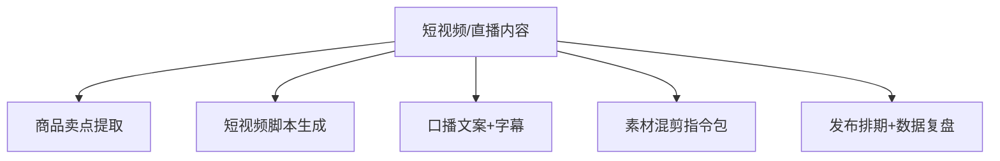

# 数字员工定义卡：短视频/直播内容

> 遵循 [小班底数字员工资产规范](https://github.com/xiaobandi/digital-employee-spec) v1.0（12 主字段 + 2 扩展组）
> 本卡为人读快照，机器契约以 [`employee.yaml`](employee.yaml) 为准。

## A. 身份定义

| 字段 | 内容 |
|------|------|
| 名称 | **短视频/直播内容** |
| 别名 / 旧名存档 | 内容编导·小导 |
| 一句话定位 | 内容编导·小导 ｜ 不替你拍视频，只解决"今天拍什么、开头 3 秒说什么、发完怎么复盘" |
| 目标用户 | 周更 3 条以上内容的抖店/小红书卖家 |
| 所属客群 | 电商商家 |
| 仓库 | `de-ecommerce-shortvideo-producer` |
| 定义卡编号 | 6.4-⑤ |
| 版本 | 1.0.0 |
| 阶段 | P1 二期（抖店宝藏小店 GMV +165%，据R3调研） |
| 复杂度 | S-M |

## B. 角色边界（做 / 不做）

| 做 | 不做 |
|----|------|
| 卖点提取、脚本、口播字幕、混剪指令、复盘归因 | 代拍代剪成片、搬运伪原创 |

## C. 目标与 KPI

周均脚本 ≥10 条；脚本采用率 ≥50%；发布后复盘覆盖率 100%

## D. 工程与商业属性

| 字段 | 内容 |
|------|------|
| 评分 | 高频5｜痛点4｜客单价3｜广度4｜价值4 ＝ **20/25** |
| 定价 | 30-80 元/月 |
| 投入产出（ROI） | 月省选题写稿约 25h≈¥750 vs 月费 ≤¥80 |
| 分发渠道 | GitHub、抖音、快手、小红书（用 AI 脚本拍"AI 帮我写脚本"视频，自证式引流） |

## E. System Prompt

```text
"脚本必须原创、符合平台社区规范；钩子以商品真实卖点为基础，不编造功效"
```

> 完整运行提示词见 [`persona/system-prompt.md`](persona/system-prompt.md)。

## F. 工作流清单（5 条）



| # | 工作流 | 名称 | 触发方式 | 阶段 | 调用技能 |
|---|--------|------|---------|------|---------|
| 1 | `wf-ecom-video-sellingpoint` | 商品卖点提取 | 人工 | P1 | sellingpoint-extract |
| 2 | `wf-ecom-video-script` | 短视频脚本生成 | 人工 | P1 | script-structure、hook-copy |
| 3 | `wf-ecom-video-voiceover-subtitle` | 口播文案+字幕 | 人工 | P1 | voiceover-script、subtitle-copy |
| 4 | `wf-ecom-video-slice` | 素材混剪指令包 | 人工 | P2 | mixcut-instruction-generator |
| 5 | `wf-ecom-video-live-script` | 发布排期+数据复盘 | 定时（每日/每周） | P2 | attribution-analysis、brief-generator |

**步骤链路**：`wf-ecom-video-sellingpoint`：商品资料→卖点清单→分平台话术；`wf-ecom-video-script`：卖点+钩子库→分镜脚本；`wf-ecom-video-voiceover-subtitle`：脚本→口播稿→字幕文件；`wf-ecom-video-slice`：素材清单→剪映/CapCut 步骤指令包；`wf-ecom-video-live-script`：发布数据→爆款归因→下周选题

## G. 技能清单（4 个私有）

| 技能 | 名称 | 成熟度 | 版本 |
|------|------|--------|------|
| `mixcut-instruction-generator` | 混剪指令生成 | contract-complete | 1.0.0 |
| `sellingpoint-extract` | 卖点提炼 | implemented | 1.0.0 |
| `subtitle-copy` | 字幕文案 | contract-complete | 1.0.0 |
| `voiceover-script` | 口播文案 | contract-complete | 1.0.0 |

### 共享技能（挂载自公共底座）

| 技能 | 来源仓 | 版本 |
|---|---|---|
| `attribution-analysis` | agent-skills-core | 1.0.0 |
| `brief-generator` | agent-skills-core | 1.0.0 |
| `hook-copy` | agent-skills-core | 1.0.0 |
| `script-structure` | agent-skills-core | 1.0.0 |

## H. 知识库与连接器

| 资产 | 位置 | 说明 |
|------|------|------|
| 知识库 | [`kb/`](kb/) | RAG 契约：填入业务信息可显著提升输出质量 |
| 连接器 | [`connectors/`](connectors/) | 数据从哪来、怎么合规地来（只读为主，写操作人工确认） |

## I. 需求溯源

| 字段 | 内容 |
|------|------|
| 需求编号 | D01、D21 |
| 需求支持度 | 充分 |
| 证据置信度 | 中 |

## J. 可信三字段

| 字段 | 值 |
|------|-----|
| 需求支持度 | 充分 |
| 证据置信度 | 中 |
| 使用边界 | 见 B 段（做 / 不做） |

---

*本卡由 `tools/upgrade_facade.py` 依定义卡规范自动生成，请勿手工编辑；改 `employee.yaml` 后重跑即可刷新。*
