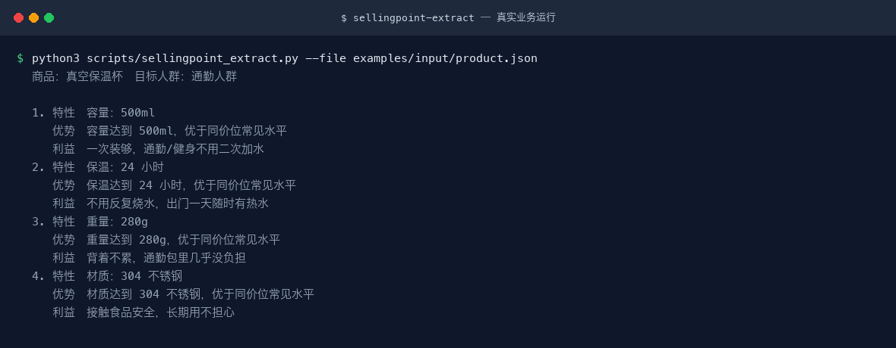
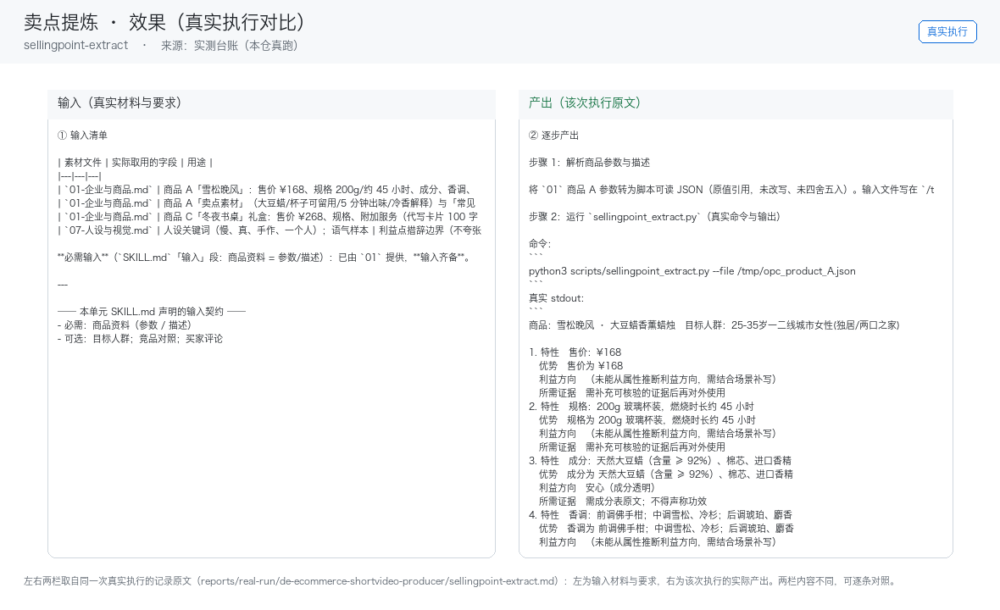

# 卖点提炼

> 从商品资料提炼结构化卖点（FAB），输出可直接喂给文案、视频、详情页的卖点卡
>
> L1 原子技能　·　复杂度 S　·　阶段 P0　·　可见性 platform_shared　·　版本 v1.0.0



*参数被翻译成 FAB（特性 → 优势 → 利益），用户看得懂才算卖点*

---

## 验收状态

本技能的验收口径见本仓 `docs/05-验收与测试.md`；测试用例见 `skills/sellingpoint-extract/tests/cases.yaml`。

---

## 解决什么问题

> ⚠️ 本技能尚未填写真实痛点（`pain_points`），下表为**通用推导**，信息量有限。

| 现实痛点 | 本技能的做法 |
|---|---|
| 「从商品资料提炼结构化卖点（FAB）」这件事靠人手工做，慢，而且每次结果不一样 | 固定成 5 步流程，同一份输入给出同一套结构，换人做也一致 |
| 机械环节人眼盯不住，会漏、会疲劳 | 由 `sellingpoint_extract.py` 承担——零依赖、可复现、零成本，退出码直接表达判定结果，能接进 CI |
| 新人不知道哪里会踩坑，重复交学费 | 已把 2 个**真实踩过的坑**写进文档，交付前逐条核对 |
| 交付物各写各的，团队没法横向比较 | 输出结构固定为「FAB 卖点卡（特性 / 优势 / 利益）」，不随执行者漂移 |

---

## 快速开始

### 1. 安装（五平台通用）

本技能是**标准 Agent 技能**：目录名 == `name`、只使用标准字段、正文里没有任何平台专有工具名。因此同一份目录可以直接用于下列平台：

| 平台 | 安装方式 |
|---|---|
| WorkBuddy | 把技能目录放到 `~/.workbuddy/skills/`，或在对话里直接说触发词 |
| ChatGPT | 打包为 zip 后在 Skills 设置里上传（需支持 Skills 的版本） |
| DeepSeek Harness | `新建技能 安装:<repo-url>`，或把目录放进 harness 的 skills 目录 |
| Kimi Work | 上传 zip 或放置到技能目录；注意 Kimi Work 不会自动触发，需显式点名技能 |
| 豆包工作 | `新建技能 安装:<repo-url>`，或在技能管理处上传 zip |

```bash
# 通用做法：把本目录整体复制到目标平台的 skills 目录
cp -r sellingpoint-extract <平台技能目录>/sellingpoint-extract
```

### 2. 在你的 Agent 里调用

**方式一 · 自动触发**（description 里已写好中英触发词）：

```text
卖点提炼　提炼卖点　商品卖点　卖点卡
```

**方式二 · 显式点名**（Kimi Work 不会自动调用，必须用这条）：

```text
用 sellingpoint-extract 技能帮我处理：<你的材料>
```

### 3. 真实跑一次（本仓库最推荐的一步）

本技能自带确定性脚本 `sellingpoint_extract.py`，零第三方依赖（仅 Python 标准库）：

```bash
python3 scripts/sellingpoint_extract.py --file examples/input/product.json
```

真实输出：`docs/images/04-terminal-run.png`；完整会话可在 `examples/output/session.txt` 查看。

> 参数被翻译成 FAB（特性 → 优势 → 利益），用户看得懂才算卖点

---

## 输出物长什么样（真实产出）

> ⚠️ **本技能的真实效果示例尚未补齐。** 以下仅为输出结构契约，**不构成效果证据**。

```markdown
| 特性 | 优势 | 利益 | 证据 |
## 按人群排序
```

---

## 适用场景与不适用场景

**适用**

- 被以下数字员工引用：Listing/详情页文案、电商短视频/直播内容
- 需要**稳定输出结构**的场景：FAB 卖点卡（特性 / 优势 / 利益）
- 适合接进自动化链路：脚本零依赖，可被 CI、定时任务或上层工作流直接调用
- 平台级公共能力，被 ≥2 个数字员工复用，改一处全库受益

**不适用（写清楚做不到什么，比列一堆能力更有用）**

- 不做功效性承诺

---

## 已知陷阱（真实踩过的坑）

> 这一段比能力列表更有用：它们是从实际使用中撞出来的，交付前请逐条核对。

- 纯参数罗列不是卖点——'500ml'是特性，'装够一天水量'才是卖点
- 卖点过多等于没有卖点，同一渠道建议主推 3 个

---

## 常见问题

**Q：脚本需要装第三方库吗？**

不需要。`sellingpoint_extract.py` 只使用 Python 标准库，`python3` 直接跑，在任意平台的沙箱里都能执行。

**Q：输出不稳定怎么办？**

先按这个顺序查：① 输入是否满足「必填」清单——缺料时应当停下来问而不是猜；② 是否走到了降级路径（有脚本的技能会在结尾说明用了哪条）；③ 对照「输出物长什么样」的结构逐项核对，缺项要求补齐而不是接受。

**Q：怎么改才能不破坏跨平台性？**

三条：目录名 == frontmatter 的 `name`；只使用标准字段（name / description / license / compatibility / metadata）；正文里不出现任何平台专有工具名，平台差异下沉到 `references/`。改完跑一次平台兼容校验。

---

## 目录结构

```text
sellingpoint-extract/
├── SKILL.md                  # 技能定义（跨平台标准）
├── README.md
├── index.html                # 交付物导航页（浏览器打开）
├── site.json                 # 导航数据
├── docs/
│   ├── 使用手册.md / .html
│   ├── 使用示例.md / .html
│   ├── 用户场景.md / .html
│   ├── 架构与流程图.md / .html
│   └── images/               # 架构图 / 流程图 / 决策矩阵 / 终端截图 / 录屏
├── references/
│   └── architecture.md       # 字段、脚本、依赖速查
├── examples/
│   ├── input/                # 真实运行夹具
│   └── output/               # 真实抓取的命令输出
├── demo/
│   └── walkthrough.html      # 演示页（真实会话回放）
├── scripts/
│   ├── check_env.py          # 环境探测与降级
│   └── sellingpoint_extract.py
```

---

## 合规与边界

- 许可：MIT；版本 v1.0.0
- 归属：Listing/详情页文案、电商短视频/直播内容
- 输出内容在对外发布前，**必须**按《广告法》与目标平台规则逐条人工复核
- 本技能不做平台官方审核的替代，只做发布前自查

---

## 深入了解

| 文档 | 用途 |
|---|---|
| `docs/使用手册.md` | 安装、参数总表、输出物说明、排错手册 |
| `docs/使用示例.md` | 可直接复制的示例，含真实运行输出节选 |
| `docs/用户场景.md` | 谁、什么时机、说什么、得到什么、注意什么 |
| `docs/架构与流程图.md` | 业务架构、执行流程、脚本与模型分工、扩展指南 |
| `references/architecture.md` | 字段、脚本、上下游依赖速查 |
| `SKILL.md` | 技能定义（触发词、能力边界、使用方式） |
| `demo/walkthrough.html` | 演示页：真实会话回放 |

演示录屏：`docs/images/08-demo-run.gif`（动图）· `docs/images/08-demo-run.mp4`（视频）
效果图：`docs/images/04-terminal-run.png`（真实运行）

<!-- media-wired -->

## 效果与证据（真实执行）



左栏是输入材料与要求，右栏是该次执行的产出原文——两栏取自同一次真实执行，不是示意图。
完整台账见 [`docs/实测记录.md`](docs/实测记录.md)（输入清单 / 逐步产出 / 质量检查 / 如实说明），
构建区原件为 `reports/real-run/de-ecommerce-shortvideo-producer/sellingpoint-extract.md`。
终端回放 [`docs/images/04-terminal-run.png`](docs/images/04-terminal-run.png)；
录屏 [`docs/images/08-demo-run.gif`](docs/images/08-demo-run.gif)　·　
[`docs/images/08-demo-run.mp4`](docs/images/08-demo-run.mp4)
（`发布标准.md` 第 8 项要求 GIF + MP4，有实测记录的单元一律生成）。

## 文档索引

| 文档 | 用途 |
|---|---|
| [`SKILL.md`](SKILL.md) | 机器契约：触发条件、输入、执行步骤、输出格式、边界 |
| [`docs/使用手册.md`](docs/使用手册.md) | 安装、触发、输入契约、输出与常见问题 |
| [`docs/使用示例.md`](docs/使用示例.md) | 真实输入 → 输出，可照着复现 |
| [`docs/用户场景.md`](docs/用户场景.md) | 谁在什么时机用、拿到什么、注意什么 |
| [`docs/架构与流程图.md`](docs/架构与流程图.md) | 分层架构 + 流程图 + 每步的承担者（脚本/模型） |
| [`docs/实测记录.md`](docs/实测记录.md) | 真实执行台账（效果证据的出处） |
| [`demo/walkthrough.html`](demo/walkthrough.html) | 不装也能在线看 |
| [`index.html`](index.html) | 单元导航页 |
| [`tests/cases.yaml`](tests/cases.yaml) | 端到端 / 闸门 / 降级用例 |
<!-- /media-wired -->
