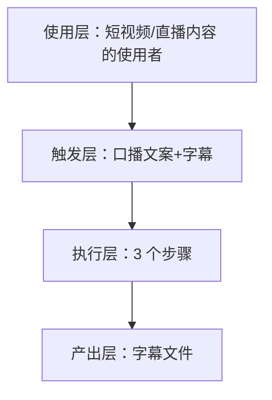
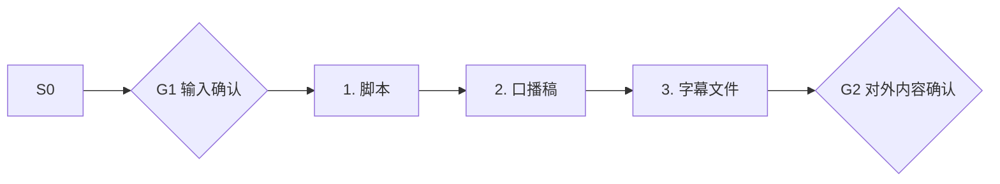

# 口播文案+字幕 · 架构与流程图

## 本工作流的四层结构

| 层 | 内容 |
|---|---|
| 使用层 | 周更 3 条以上内容的抖店/小红书卖家；员工定位：内容编导·小导 ｜ 不替你拍视频，只解决"今天拍什么、开头 3 秒说什么、发完怎么复盘" |
| 触发层 | 关键词 / 显式点名「口播文案+字幕」；触发方式：人工 |
| 执行层 | 脚本 → 口播稿 → 字幕文件 |
| 产出层 | 字幕文件 |

## 执行流程

## 步骤职责表

| # | 步骤 | 承担者 | 为什么 |
|---|---|---|---|
| 1 | 脚本 | 模型 | 需要读懂语境，不可用固定规则替代 |
| 2 | 口播稿 | 模型 | 需要读懂语境，不可用固定规则替代 |
| 3 | 字幕文件 | 模型 | 需要读懂语境，不可用固定规则替代 |

⚠️ 尚未补齐：图中的步骤来自注册表口径，未逐条实跑校验；实跑后请同步修订本页（`发布标准.md` 第六项：通读一遍，不得出现重复填充句）。
